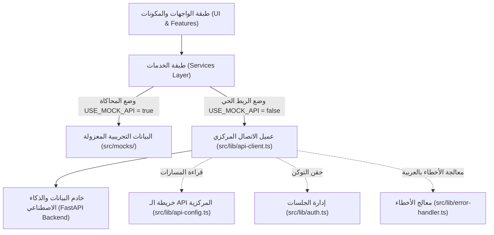

# الوثيقة الفنية الشاملة لمعمارية وهندسة المنصة
## (AI Business Intelligence Platform - Architecture & API Guide)

---

> [!NOTE]
> **حالة المنصة الحالية:** جاهزة بنسبة 100% برمجياً وتصميمياً، وتدعم اللغة العربية والـ RTL أصلياً، مع تكامل كامل لطبقة الاتصال بالخادم (API Layer) ونظام التبديل الذكي بين وضع المحاكاة التجريبية والربط الفعلي بخادم FastAPI.

---

## 📑 فهرس المحتويات
1. [نبذة عامة عن المشروع والهندسة المعمارية](#1-نبذة-عامة-عن-المشروع-والهندسة-المعمارية)
2. [الهيكل الشامل للملفات ووظيفة كل كود بالتفصيل](#2-الهيكل-الشامل-للملفات-ووظيفة-كل-كود-بالتفصيل)
3. [دليل الشاشات الثماني: ماذا يعمل كل كود وأين يوجد](#3-دليل-الشاشات-الثماني-ماذا-يعمل-كل-كود-وأين-يوجد)
4. [الكتالوج الشامل لمسارات الـ APIs الافتراضية لكل شاشة](#4-الكتالوج-الشامل-لمسارات-الـ-apis-الافتراضية-لكل-شاشة)
5. [دليل استبدال الـ APIs الافتراضية بـ APIs حقيقية (خطوة بخطوة)](#5-دليل-استبدال-الـ-apis-الافتراضية-بـ-apis-حقيقية-خطوة-بخطوة)
6. [نظام التصميم والهوية المؤسسية (Design System)](#6-نظام-التصميم-والهوية-المؤسسية-design-system)

---

## 1. نبذة عامة عن المشروع والهندسة المعمارية

مشروع **منصة ذكاء الأعمال والذكاء الاصطناعي (AI BI Platform)** مبني بأحدث معايير الويب:
- **Next.js 16.4 (App Router & Turbopack)**
- **React 19**
- **TypeScript 5 (Strict Mode)**
- **Tailwind CSS v4**
- **IBM Plex Sans Arabic + JetBrains Mono**

### المعمارية ثلاثية الطبقات (Three-Tier Architecture):


---

## 2. الهيكل الشامل للملفات ووظيفة كل كود بالتفصيل

### 1. مجلد التهيئة والاتصال المركزي (`src/lib/`)

| اسم الملف | مكان وجوده | ماذا يعمل وما هي مسؤوليته البرمجية؟ |
| :--- | :--- | :--- |
| **`api-config.ts`** | `src/lib/api-config.ts` | **الملف الأهم لاستبدال الـ APIs**: يقرأ عنوان الخادم `NEXT_PUBLIC_API_BASE_URL` ومفتاح `USE_MOCK_API`. يحتوي على كائن `API_ENDPOINTS` الذي يجمع كافة روابط الشاشات الثماني في مكان واحد مركزي. |
| **`api-client.ts`** | `src/lib/api-client.ts` | **محرك الاتصال المركزي**: ينفذ دالة `apiRequest<T>()` المعتمدة على `fetch`. يقوم تلقائياً بدمج رابط الخادم، حقن ترويسة التوثيق `Authorization: Bearer <token>`، ضبط نوع المحتوى لـ JSON، واعتراض الأخطاء. |
| **`auth.ts`** | `src/lib/auth.ts` | **مدير جلسة وتوكن المستخدم**: مسؤول عن حفظ وجلب ومسح الـ JWT Token في `localStorage` ومزامنته فورياً مع كوكيز المتصفح (`document.cookie`) لتمكين السيرفر والميدلوير من قراءته. |
| **`error-handler.ts`** | `src/lib/error-handler.ts` | **المترجم المركزي للأخطاء**: فئة `ApiError` ودالة `handleApiError` التي تعترض رموز HTTP (مثل 401, 403, 404, 422, 500) وانقطاع الشبكة وتحولها إلى رسائل عربية واضحة للمستخدم. |
| **`supabase/`** | `src/lib/supabase/` | عملاء الربط مع Supabase Auth للمتصفح والسيرفر والميدلوير (`client.ts`, `server.ts`, `middleware.ts`). |

---

### 2. طبقة الخدمات (`src/services/`)

تطبق جميع ملفات الخدمات نمط **التبديل الثنائي الذكي (Dual-Mode)**:

```typescript
// النمط المعماري الموحد المطبق داخل كل دالة خدمة:
export async function getSomeData() {
  if (USE_MOCK_API) {
    // 1. تنفيذ منطق المحاكاة التجريبي المحلي
    return mockData;
  }
  // 2. الاستدعاء الفعلي لنقطة نهاية الخادم
  return await apiRequest(API_ENDPOINTS.SOME_MODULE.SOME_PATH);
}
```

| ملف الخدمة | مكانه | العمليات والوظائف البرمجية داخله |
| :--- | :--- | :--- |
| **`auth.service.ts`** | `src/services/auth.service.ts` | دوال تسجيل الدخول `login`، إنشاء الحساب `register`، استعادة كلمة المرور `forgotPassword`، الخروج `logout`، واسترداد بيانات المستخدم `getCurrentUser`. |
| **`dashboard.service.ts`** | `src/services/dashboard.service.ts` | دالة `getDashboardData` لجلب مؤشرات الأداء، الأنشطة الأخيرة، وأحدث التقارير. تدعم محاكاة حالات الخطأ والفراغ. |
| **`data-sources.service.ts`** | `src/services/data-sources.service.ts` | دوال جلب المصادر `getDataSources`، فحص الاتصال التجريبي/الفعلي `testConnectionMock`، الإضافة `createMockDataSource`، التعديل `updateMockDataSource`، والحذف `deleteMockDataSource`. |
| **`documents.service.ts`** | `src/services/documents.service.ts` | دوال جلب المستندات `getDocuments`، رفع ملف جديد `addMockDocument`، إعادة معالجة الفهرسة الفاشلة `retryProcessingMock`، وحذف المستند `deleteMockDocument`. |
| **`chat.service.ts`** | `src/services/chat.service.ts` | دالة `askQuestion` القياسية للذكاء الاصطناعي، دالة إرسال الرسالة `sendChatMessage` مع دعم نطاق المعرفة (Scope)، جلب الجلسات السابقة `fetchChatSessions`، والأسئلة السريعة `fetchQuickPrompts`. |
| **`analytics.service.ts`** | `src/services/analytics.service.ts` | دوال جلب المؤشرات والرسوم البيانية `getAnalyticsData` وفق المدى الزمني والفلتر، واستعلام التحليلات المخصص `queryAnalytics`. |
| **`reports.service.ts`** | `src/services/reports.service.ts` | دوال جلب سجل التقارير `getReports`، إعادة توليد التقرير `retryGenerateReportMock`، حذف التقرير `deleteReportMock`، وتنزيل الملف `downloadReport`. |
| **`profile.service.ts`** | `src/services/profile.service.ts` | دوال جلب الملف الشخصي `getSettingsData`، تحديث البيانات `updateProfileMock`، حفظ تفضيلات المظهر `updateUiPreferencesMock`، وتفضيلات الإشعارات `updateNotificationPreferencesMock`. |

---

## 3. دليل الشاشات الثماني: ماذا يعمل كل كود وأين يوجد

### 1. شاشة تسجيل الدخول (`/login`)
- **الملف الرئيسي:** `src/app/(auth)/login/page.tsx`
- **ماذا يعمل الكود:**
  - واجهة مؤسسية راقية مع تأثيرات بلور زجاجية.
  - تقبل الدخول التجريبي الفوري بنقرة واحدة عبر زر **"دخول تجريبي فوري (حساب المسؤول)"** في وضع `USE_MOCK_API=true` دون الحاجة لأي خادم أو مفاتيح مسبقة.
  - في حال تعيين `USE_MOCK_API=false`، تتصل فورياً بنقطة نهاية FastAPI عبر `API_ENDPOINTS.AUTH.LOGIN`.
  - تعرض رسائل الخطأ مترجمة بالعربية وتوجه المستخدم تلقائياً إلى لوحة التحكم `/dashboard`.

---

### 2. شاشة لوحة التحكم والمؤشرات (`/dashboard`)
- **الملف الرئيسي:** `src/app/(main)/dashboard/page.tsx`
- **المكونات المستدعاة:** `src/components/ui/StatCard.tsx`
- **ماذا يعمل الكود:**
  - استعراض 4 بطاقات مؤشرات رئيسية (الاستفسارات الذكية، مصادر البيانات المتصلة، المستندات المفهرسة، صحة النظام).
  - بطاقة تحفيزية علوية للانتقال الفوري لمحادثة الذكاء الاصطناعي (`/chat`).
  - سجل الأنشطة الأخيرة وسجل التقارير الجاهزة مع تنبيهات عند النقر على التنزيل التجريبي.
  - تحتوي على شريط أدوات تطوير منبثق (`DevTools Switcher`) للمعاينة الفورية لكافة حالات الشاشة (طبيعية، تحميل، خطأ، فارغة).

---

### 3. مساحة عمل محادثة الذكاء الاصطناعي (`/chat`)
- **الملف الرئيسي:** `src/app/(main)/chat/page.tsx`
- **المكونات المستدعاة:**
  - `src/features/chat/ChatReasoningStepper.tsx` (شريط مراحل تفكير الوكيل)
  - `src/features/chat/ChatMessageItem.tsx` (بطاقة مساحة عمل رد الوكيل)
  - `src/features/chat/ChatInput.tsx` (حقل الإدخال ومحدد نطاق المعرفة)
  - `src/features/chat/ChatSidebar.tsx` (قائمة الجلسات السابقة)
  - `src/features/chat/ChatWelcomeScreen.tsx` (شاشة الترحيب والأسئلة المقترحة)
- **ماذا يعمل الكود:**
  - **محدد نطاق المعرفة (Context Scope):** يتيح للمستخدم تحديد نطاق السؤال قبل الإرسال (`🌐 كافة المصادر والمستندات`، `🗄️ قواعد البيانات المركزية`، `📄 قاعدة المعرفة والمستندات`).
  - **شريط تفكير الوكيل (AI Reasoning Stepper):** يعرض مؤشر متحرك يوضح للمستخدم مراحل العمل الحية (1. فهم وتحليل السؤال ➔ 2. استعلام مصادر البيانات واسترجاع فهارس RAG ➔ 3. صياغة التحليل والرؤى).
  - **بطاقة مساحة عمل الرد (Workspace Response Card):**
    - ملخص تنفيذي مقروء.
    - بطاقات الرؤى التحليلية الأساسية (Key Insights Cards) بخاصية `.tabular-nums`.
    - منطقة عرض الجداول المستخرجة.
    - مراجع المستندات ونسب الثقة ومقتطفات الصفحات (RAG Citations).
    - أزرار سريعة: نسخ الإجابة، الانتقال للتحليلات `/analytics`، أو إنشاء تقرير فوري `/reports`.
  - **دعم النتيجة الجزئية (Partial Results):** معالجة مرنة في حال تعذر رسم المخطط البياني وعرض التنبيه مع بقاء النص والرؤى سليمة.

---

### 4. شاشة إدارة مصادر البيانات (`/data-sources`)
- **الملف الرئيسي:** `src/app/(main)/data-sources/page.tsx`
- **المكونات المستدعاة:**
  - `src/features/data-sources/DataSourceTable.tsx` (جدول وبطاقات المصادر)
  - `src/features/data-sources/DataSourceFilters.tsx` (شريط البحث والفلترة)
  - `src/features/data-sources/DataSourceModal.tsx` (نافذة إضافة وتعديل مصدر)
  - `src/features/data-sources/DataSourceDetailsModal.tsx` (استعراض مخطط الجداول والأعمدة Schema)
  - `src/features/data-sources/DeleteConfirmModal.tsx` (تأكيد الحذف)
- **ماذا يعمل الكود:**
  - إدارة مصادر البيانات من مختلف الأنواع (PostgreSQL, MySQL, REST API, CSV/Excel, MongoDB).
  - إجراء فحص اتصال تفاعلي حي بمؤشرات تحميل وشارات نجاح أو تنبيه.
  - استعراض المخطط الهيكلي لقواعد البيانات (Schema Viewer).
  - فلاتر سريعة للبحث الفوري حسب النوع وحالة الاتصال.

---

### 5. شاشة المستندات وقاعدة المعرفة (`/documents`)
- **الملف الرئيسي:** `src/app/(main)/documents/page.tsx`
- **المكونات المستدعاة:**
  - `src/features/documents/DocumentUploadArea.tsx` (منطقة سحب وإفلات الملفات)
  - `src/features/documents/DocumentFilters.tsx` (شريط الفلاتر والإحصائيات السريعة)
  - `src/features/documents/DocumentTable.tsx` (جدول المستندات وقائمة المعاينة)
  - `src/features/documents/DocumentDetailsModal.tsx` (نافذة تفاصيل المستند)
  - `src/features/documents/DocumentDeleteModal.tsx` (نافذة تأكيد الحذف)
- **ماذا يعمل الكود:**
  - منطقة سحب وإفلات محاكية لرفع ملفات PDF, DOCX, XLSX, CSV.
  - شريط إحصائي حي لأعداد المستندات المفهرسة وتلك التي قيد المعالجة.
  - إمكانية إعادة معالجة المستندات المتعثرة وتحديث حالتها.

---

### 6. شاشة التحليلات ومؤشرات الأداء (`/analytics`)
- **الملف الرئيسي:** `src/app/(main)/analytics/page.tsx`
- **المكونات المستدعاة:**
  - `src/features/analytics/AnalyticsFilters.tsx` (محدد المدى الزمني: 7d, 30d, 90d, 1y)
  - `src/features/analytics/AnalyticsKpiGrid.tsx` (شبكة بطاقات الأداء)
  - `src/features/analytics/AnalyticsTrendChart.tsx` (رسم بياني نقي Area SVG Chart لمسار الاستفسارات)
  - `src/features/analytics/AnalyticsCategoryChart.tsx` (مخطط أعمدة SVG لتصنيفات الاستعلام)
  - `src/features/analytics/AnalyticsDistributionCard.tsx` (توزيع مصادر الاستفسارات)
- **ماذا يعمل الكود:**
  - لوحة تحليلات بصرية نقية (Native SVG) خفيفة وسريعة لا تعتمد على مكتبات خارجية ثقيلة.
  - متوافقة 100% مع الاتجاه العربي RTL و React 19.
  - تتفاعل فورياً مع تبديل النطاق الزمني ونوع المؤشر.

---

### 7. شاشة التقارير وسجلات التصدير (`/reports`)
- **الملف الرئيسي:** `src/app/(main)/reports/page.tsx`
- **المكونات المستدعاة:**
  - `src/features/reports/ReportsFilters.tsx` (فلاتر الفئة والصيغة والحالة)
  - `src/features/reports/ReportsTable.tsx` (جدول سجل التقارير)
  - `src/features/reports/ReportPreviewModal.tsx` (نافذة المعاينة السريعة للتقرير)
  - `src/features/reports/ReportDetailsModal.tsx` (نافذة تفاصيل ونطاق التقرير)
- **ماذا يعمل الكود:**
  - استعراض سجل التقارير المالية والتشغيلية وأداء النماذج.
  - إتاحة معاينة محتوى التقرير بنقرة واحدة داخل نافذة منبثقة دون مغادرة الشاشة.
  - دعم التصدير بصيغ متعددة (PDF, XLSX, CSV).

---

### 8. شاشة الإعدادات والتفضيلات (`/settings`)
- **الملف الرئيسي:** `src/app/(main)/settings/page.tsx`
- **المكونات المستدعاة:**
  - `src/features/settings/SettingsNavTabs.tsx` (ألسنة التبويب الداخلية)
  - `src/features/settings/ProfileSection.tsx` (بيانات الملف الشخصي والمؤسسة)
  - `src/features/settings/PreferencesSection.tsx` (المظهر، حجم الخط IBM Plex، وتلميحات الذكاء الاصطناعي)
  - `src/features/settings/NotificationsSection.tsx` (تفضيلات الإشعارات)
  - `src/features/settings/SecurityOverviewSection.tsx` (نظرة عامة على الأمان والتوثيق)
  - `src/features/settings/LogoutConfirmModal.tsx` (نافذة تأكيد تسجيل الخروج)
- **ماذا يعمل الكود:**
  - إدارة كاملة لمعلومات الحساب مع حفظ التعديلات محلياً وإظهار إشعارات نجاح عائمة.
  - تحكم بتفضيلات المظهر والخطوط.
  - زر تسجيل الخروج مع نافذة تأكيد ومسح الجلسة وتوجيه المستخدم لصفحة الدخول.

---

## 4. الكتالوج الشامل لمسارات الـ APIs الافتراضية لكل شاشة

> [!IMPORTANT]
> 
> **يوجد، 100%.** لجميع الشاشات الثماني مبرمجة ومربوطة بمسارات API افتراضية متطابقة مع وثيقة الفريق الرسمية، ومكتوبة وجاهزة داخل دوال `src/services/` استناداً إلى كائن `API_ENDPOINTS` في `src/lib/api-config.ts`.

| الشاشة | العملية / الوظيفة | اسم الدالة في Service | نوع الطلب | المسار الافتراضي المحدد في `api-config.ts` |
| :--- | :--- | :--- | :---: | :--- |
| **المصادقة (Auth)** | تسجيل الدخول | `login()` | `POST` | `/api/v1/auth/login` |
| | إنشاء حساب جديد | `register()` | `POST` | `/api/v1/auth/register` |
| | استعادة كلمة المرور | `forgotPassword()` | `POST` | `/api/v1/auth/forgot-password` |
| | تسجيل الخروج | `logout()` | `POST` | `/api/v1/auth/logout` |
| | استرداد المستخدم الحالي | `getCurrentUser()` | `GET` | `/api/v1/auth/me` |
| **لوحة التحكم (Dashboard)** | ملخص المؤشرات | `getDashboardData()` | `GET` | `/api/v1/dashboard/summary` |
| | مصادر البيانات للوحة | `getDashboardData()` | `GET` | `/api/v1/data-sources` |
| | ملخص المستندات | `getDashboardData()` | `GET` | `/api/v1/documents/summary` |
| | أحدث التقارير | `getDashboardData()` | `GET` | `/api/v1/reports/recent` |
| **مصادر البيانات (Data Sources)** | جلب قائمة المصادر | `getDataSources()` | `GET` | `/api/v1/data-sources` |
| | إنشاء مصدر جديد | `createDataSource()` | `POST` | `/api/v1/data-sources` |
| | تعديل مصدر بيانات | `updateDataSource()` | `PUT` | `/api/v1/data-sources/:id` |
| | فحص اتصال المصدر | `testDataSourceConnection()` | `POST` | `/api/v1/data-sources/:id/test-connection` |
| | حذف مصدر بيانات | `deleteDataSource()` | `DELETE` | `/api/v1/data-sources/:id` |
| **المستندات (Documents)** | جلب قائمة المستندات | `getDocuments()` | `GET` | `/api/v1/documents` |
| | رفع مستند جديد | `uploadDocument()` | `POST` | `/api/v1/documents` |
| | تفاصيل وحالة المستند | `getDocuments()` | `GET` | `/api/v1/documents/:id` |
| | متابعة حالة الفهرسة | `getDocuments()` | `GET` | `/api/v1/documents/:id/status` |
| | إعادة معالجة المستند | `retryDocumentProcessing()` | `POST` | `/api/v1/documents/:id/retry` |
| | حذف مستند | `deleteDocument()` | `DELETE` | `/api/v1/documents/:id` |
| **المحادثة الذكية (AI Chat)** | إرسال سؤال للذكاء الاصطناعي | `askQuestion()` | `POST` | `/api/v1/ai/ask` |
| | جلب جلسات المحادثة | `fetchChatSessions()` | `GET` | `/api/v1/conversations` |
| | رسائل جلسة معينة | `fetchChatSessions()` | `GET` | `/api/v1/conversations/:id/messages` |
| **التحليلات (Analytics)** | جلب ملخص المؤشرات | `getAnalyticsData()` | `GET` | `/api/v1/analytics` |
| | استعلام تحليلي مخصص | `queryAnalytics()` | `POST` | `/api/v1/analytics/query` |
| | مؤشر تفصيلي بالمعرف | `getAnalyticsData()` | `GET` | `/api/v1/analytics/:id` |
| **التقارير (Reports)** | جلب سجل التقارير | `getReports()` | `GET` | `/api/v1/reports` |
| | إنشاء / توليد تقرير | `retryGenerateReport()` | `POST` | `/api/v1/reports/:id` |
| | تنزيل ملف التقرير | `downloadReport()` | `GET` | `/api/v1/reports/:id/download` |
| | حذف تقرير | `deleteReport()` | `DELETE` | `/api/v1/reports/:id` |
| **الملف الشخصي والإعدادات (Profile)** | جلب الملف الشخصي | `getUserProfile()` | `GET` | `/api/v1/auth/me` |
| | تحديث بيانات المستخدم | `updateUserProfile()` | `PUT` | `/api/v1/users/me` |
| | تسجيل الخروج | `logoutUser()` | `POST` | `/api/v1/auth/logout` |

---

## 5. دليل استبدال الـ APIs الافتراضية بـ APIs حقيقية (خطوة بخطوة)

> [!TIP]
> **في أي ملف يوجد الاستبدال؟**
> الاستبدال يتم في **ملفين فقط** على مستوى المشروع بأكمله:
> 1. ملف **`src/lib/api-config.ts`** (لتعديل المسارات إن اختلفت أسماؤها لدى فريق الـ Backend).
> 2. ملف **`.env.local`** (لتوجيه الاتصال إلى خادم الـ Backend وإيقاف وضع المحاكاة).
> 
> **لن تحتاج للمساس بأي شاشة أو زر أو مكون في الواجهة إطلاقاً!**

### خطوات الاستبدال العملية:

#### الخطوة 1: ضبط متغيرات البيئة في `.env.local`
افتح ملف `.env.local` في جذر المشروع، وضع رابط خادم FastAPI الحقيقي وقم بتعطيل وضع المحاكاة:

```env
# 1. عنوان خادم الـ Backend الفعلي (محلي أو سحابي)
NEXT_PUBLIC_API_BASE_URL=http://127.0.0.1:8000

# 2. إيقاف وضع المحاكاة لتفعيل الاتصال الحقيقي
NEXT_PUBLIC_USE_MOCK_API=false
```

#### الخطوة 2: مطابقة المسارات في `src/lib/api-config.ts` (إن لزم الأمر)
إذا قام فريق الـ Backend بتغيير أي مسار (مثلاً بدلاً من `/api/v1/ai/ask` استخدموا `/api/v1/chat/completions`)، افتح ملف `src/lib/api-config.ts` وعدّل السطر المقابل فقط:

```typescript
// src/lib/api-config.ts
export const API_ENDPOINTS = {
  // ...
  AI_CHAT: {
    // غيّر هذا السطر فقط للمسار الذي يعطيك إياه زميلك:
    ASK: "/api/v1/chat/completions",
    CONVERSATIONS: "/api/v1/conversations",
    MESSAGES: (id: string | number) => `/api/v1/conversations/${id}/messages`,
  },
  // ...
};
```

بمجرد حفظ هذين الملفين، ستتحول كافة الشاشات الثماني فورياً وتلقائياً إلى إرسال واستقبال البيانات الحقيقية من خادم الـ Backend مع التوثيق الكامل بالتوكن!

---

## 6. نظام التصميم والهوية المؤسسية (Design System)

- **الخط الأساسي للنصوص:** `IBM Plex Sans Arabic` بأوزانه (`300, 400, 500, 600, 700`).
- **الخط التقني للأرقام:** `JetBrains Mono` لجداول البيانات والأكواد والشارات.
- **ثبات الأرقام (`.tabular-nums`):** مطبق على الجداول وبطاقات المؤشرات لمنع اهتزاز الأرقام.
- **لوحة الألوان المعتمدة:**
  - خلفية المحتوى: `#F8FAFC` (`bg-slate-50`).
  - النصوص الرئيسية: `#0F172A` (`text-slate-900`).
  - الشريط الجانبي الداكن: `#0B132B`.
  - الأزرق المؤسسي: `#2563EB`.
  - البنفسجي الذكي للـ AI: `#7C3AED`.
  - الأخضر التشغيلي والنجاح: `#16A34A`.
