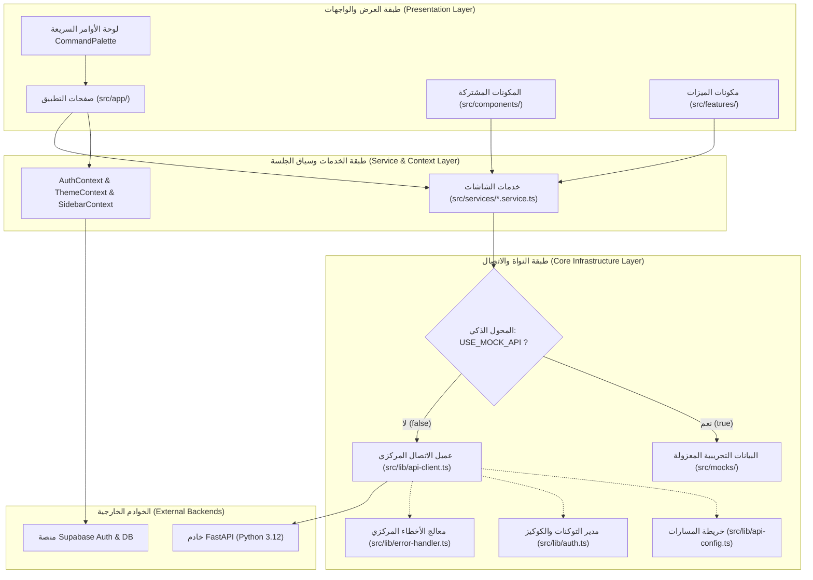
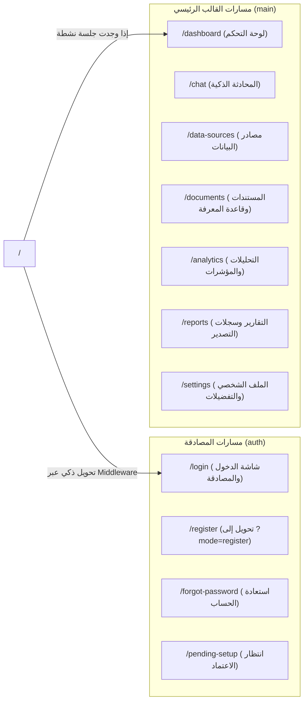

# التقرير الفني الشامل والتفصيلي لمشروع منصة ذكاء الأعمال والذكاء الاصطناعي
## Enterprise AI Business Intelligence & Knowledge Platform

---

## 📌 الفهرس العام للتقرير
1. [الملخص التنفيذي ونطاق المشروع](#1-الملخص-التنفيذي-ونطاق-المشروع)
2. [المكدس التقني والمعايير الهندسية](#2-المكدس-التقني-والمعايير-الهندسية)
3. [المعمارية ثلاثية الطبقات (Three-Tier Architecture) ومخطط التدفق](#3-المعمارية-ثلاثية-الطبقات-ومخطط-التدفق)
4. [نظام التصميم، الألوان، الخطوط، والتأثيرات البصرية](#4-نظام-التصميم-الألوان-الخطوط-والتأثيرات-البصرية)
5. [خريطة المسارات والتوجيه (Routing & Navigation)](#5-خريطة-المسارات-والتوجيه)
6. [الفهرس التشريحي لكافة ملفات وأكواد المشروع (ملفاً بملف)](#6-الفهرس-التشريحي-لكافة-ملفات-وأكواد-المشروع)
   - [أ. ملفات التهيئة في الجذر (Root Configs)](#أ-ملفات-التهيئة-في-الجذر)
   - [ب. مسارات صفحات التطبيق (`src/app/`)](#ب-مسارات-صفحات-التطبيق)
   - [ج. سياقات إدارة الحالة المشتركة (`src/context/`)](#ج-سياقات-إدارة-الحالة-المشتركة)
   - [د. عملاء الاتصال والبنية التحتية (`src/lib/`)](#د-عملاء-الاتصال-والبنية-التحتية)
   - [هـ. المكونات المشتركة العامة (`src/components/`)](#هـ-المكونات-المشتركة-العامة)
   - [و. مكونات الميزات والشاشات (`src/features/`)](#و-مكونات-الميزات-والشاشات)
   - [ز. طبقة الخدمات البرمجية (`src/services/`)](#ز-طبقة-الخدمات-البرمجية)
   - [ح. طبقة البيانات التجريبية للمحاكاة (`src/mocks/`)](#ح-طبقة-البيانات-التجريبية-للمحاكاة)
   - [ط. طبقة الأنواع وتعريفات TypeScript (`src/types/`)](#ط-طبقة-الأنواع-وتعريفات-typescript)
7. [آلية التحول والربط بالخادم الحقيقي (FastAPI / Supabase Integration)](#7-آلية-التحول-والربط-بالخادم-الحقيقي)

---

## 1. الملخص التنفيذي ونطاق المشروع

مشروع **واجهات منصة ذكاء الأعمال والذكاء الاصطناعي (AI Business Intelligence Platform)** هو منصة ويب مؤسسية متقدمة من الدرجة الأولى (Enterprise-grade SaaS)، مصممة لتمكين المؤسسات من استنطاق مستودعات بياناتها، واستخراج الرؤى التحليلية عبر وكلاء الذكاء الاصطناعي (AI Agents)، ومحركات التوليد المعزز بالاسترجاع (RAG - Retrieval-Augmented Generation).

### المزايا الجوهرية للمنصة:
- **دعم اللغة العربية أصلياً (RTL First):** تصميم هادف ومريح للعين مع تناسق كامل في محاذاة الجداول، المخططات البيانية، والنوافذ المنبثقة.
- **معمارية ثنائية التبديل (Dual-Mode Architecture):** تعمل الواجهة بكامل وظائفها التفاعلية في وضع المحاكاة المعزول (`Mock API Mode`) بدون الحاجة لأي خادم خلفي، مع جاهزية تامة بنسبة 100% للربط الفوري بخادم `FastAPI` أو قاعدة بيانات `Supabase` بمجرد تغيير متغير بيئة واحد (`NEXT_PUBLIC_USE_MOCK_API=false`).
- **واجهة مستخدم زجاجية فاخرة (Dark Glassmorphism & Light Corporate):** تجمع بين الأسلوب المؤسسي الهادئ في الوضع النهاري، والوضع الليلي المتطور المستوحى من أحدث منصات الـ SaaS العالمية (مثل 21st.dev).

---

## 2. المكدس التقني والمعايير الهندسية

| الحزمة البرمجية | الإصدار المعتمد | الدور الهندسي في المشروع |
| :--- | :--- | :--- |
| **Next.js** | `16.4.0` | إطار العمل الرئيسي بالاعتماد على بنية `App Router` الحديثة، محرك `Turbopack` السريع، وتقنية التقديم المسبق الجزئي (`Partial Prefetching`). |
| **React** | `19.3.0` | مكتبة واجهات المستخدم، مع تفعيل مترجم ريأكت الرسمي (`React Compiler`) لتحسين كفاءة إعادة التصيير وتجنب استهلاك الذاكرة. |
| **TypeScript** | `^5.0.0` | أمان الأنواع الصارم عبر كافة أجزاء المشروع، وتطبيق واجهات موحدة للطلبات والاستجابات. |
| **Tailwind CSS** | `v4.0.0` | الجيل الرابع المعتمد على متغيرات CSS النقية ومحرك Turbopack دون الحاجة لملف إعدادات قديم `tailwind.config.js`. |
| **Lucide React** | `^1.55.0` | مكتبة أيقونات متجهة عالية الدقة وموحدة دلالياً في كافة الشاشات. |
| **@supabase/ssr & @supabase/supabase-js** | `^0.12.7` / `^2.117.3` | إدارة جلسات المستخدمين في جانب العميل والسيرفر عبر الكوكيز الآمنة. |
| **Google Fonts (IBM Plex Sans Arabic & JetBrains Mono)** | أحدث إصدار سحابي | خطوط عربية ولاتينية عالية المقروئية، مع خط مونو للأكواد والأرقام الفنية. |
| **Native SVG Charting Engine** | كود نقي مخصص | محرك رسوم بيانية ذاتي البناء بدون مكتبات خارجية لتفادي مشاكل عدم توافق React 19، يدعم خطوط الاتجاه (Trend Area)، وأعمدة التوزيع (Bar Charts)، وتوزيع الحصص الدائري (Donut Segments). |

---

## 3. المعمارية ثلاثية الطبقات ومخطط التدفق

تتبع المنصة هيكلية معمارية نظيفة ثلاثية المستويات تعزل واجهات المستخدم تماماً عن أسلوب جلب البيانات:



---

## 4. نظام التصميم، الألوان، الخطوط، والتأثيرات البصرية

تم بناء الهوية البصرية ونظام الرموز (`Design System Tokens`) في ملف [globals.css](file:///d:/graduation-project-interfaces/src/app/globals.css) لتقديم تباين متوازن يجمع بين راحة العين للبيانات المكثفة وفخامة الذكاء الاصطناعي:

### أ. لوحة الألوان المعتمدة (Color Palette)

| اسم الرمز (Token) | القيمة اللونية (HEX) | المتغير (CSS Variable) | دور اللون واستخدامه في النظام |
| :--- | :--- | :--- | :--- |
| **Primary Blue** | `#2563EB` | `--color-primary` | اللون المؤسسي الأساسي: أزرار الحفظ والإرسال، روابط القائمة النشطة، ومؤشرات البيانات العامة. |
| **Primary Hover** | `#1D4ED8` | `--color-primary-hover` | لون التمرير التفاعلي للأزرار الرئيسية. |
| **Primary Light** | `#EFF6FF` | `--color-primary-light` | خلفيات الشارات والبطاقات الفاتحة للأزرق. |
| **AI Violet** | `#7C3AED` | `--color-ai` | هوية الذكاء الاصطناعي: شارات الـ AI، شاشة المحادثة الذكية، وخطوات التفكير الاستدلالي (Reasoning). |
| **AI Hover** | `#6D28D9` | `--color-ai-hover` | لون التمرير لأزرار وإجراءات الذكاء الاصطناعي. |
| **AI Light** | `#F5F3FF` | `--color-ai-light` | الهالة المحيطية خلف مكونات الذكاء الاصطناعي. |
| **Sync Cyan** | `#0891B2` | `--color-sync` | تدفق البيانات والمزامنة: مصادر البيانات، قواعد البيانات، والرسوم البيانية المترابطة. |
| **Success Emerald** | `#16A34A` | `--color-success` | مؤشرات النجاح: اكتمال المزامنة، صحة الاتصال، واستقرار النظام بنسبة 100%. |
| **Warning Amber** | `#D97706` | `--color-warning` | مؤشرات التنبيه: الفهرسة الجارية، المعالجة، والتقارير قيد التوليد. |
| **Danger Rose** | `#DC2626` | `--color-danger` | مؤشرات الخطر: فشل الاتصال، نوافذ الحذف، والرسائل التحذيرية. |
| **Sidebar Navy** | `#0B132B` | `--color-sidebar-bg` | خلفية الشريط الجانبي الثابت: كحلي داكن ليلي عالي التباين والأناقة. |
| **Dark Background** | `#070B19` | `--color-background` (Dark) | الخلفية الليلية الكونية الفاخرة للوضع الداكن. |
| **Dark Glass Surface** | `rgba(15,23,42,0.65)` | `--color-surface` (Dark) | أسطح البطاقات الزجاجية مع تأثير الضبابية `backdrop-blur-xl`. |
| **Light Background** | `#F8FAFC` | `--color-background` (Light) | الخلفية النهارية المؤسسية الهادئة المريحة للعين لقراءة الأرقام. |

### ب. منظومة الخطوط (Typography)
- **الخط الأساسي للنصوص:** `IBM Plex Sans Arabic` تم استدعاؤه بأوزان متعددة (300 إلى 700) عبر `next/font/google` لضمان قراءة عربية فائقة الوضوح.
- **الخط التقني للأرقام والأكواد:** `JetBrains Mono` مخصص للمؤشرات الإحصائية، أزمنة الاستجابة، والأكواد.
- **تثبيت عرض الأرقام (`tabular-nums`):** فئة CSS مخصصة تُطبق `font-variant-numeric: tabular-nums` لمنع اهتزاز الأرقام عند تحديث العدادات والجداول.

### ج. المكونات التفاعلية والجماليات الفريدة
1. **مفتاح الليل والنهار السماوي (`DayNightSwitch`):** مفتاح تفاعلي فائق النعومة، يظهر في الوضع النهاري غيوماً متداخلة وشعاع شمس ذهبي، ويتحول بسلاسة في الوضع الليلي إلى سماء مظلمة بها نجوم متلألئة وقمر متوهج مع تتبع كامل للكوكيز وحالة النظام.
2. **بطاقات التوهج التفاعلية (`GlowCard`):** بطاقات مزودة بمستشعر حركة للماوس يولد هالة ضوئية شعاعية (`radial-gradient`) تتبع مؤشر الفأرة على حواف وزوايا البطاقة بحسب لون المؤشر (أزرق، بنفسجي، زمردي، سيان، كهرماني).
3. **خلفية الصحراء الليلية الكونية (`NightDesertBackground`):** مكون سينمائي لشاشات تسجيل الدخول واستعادة كلمة المرور، يضم قمراً ضخماً بهالات ضوئية، و 45 نجمة عشوائية تنبض بحركات فيزيائية، وكثباناً رملية مظللة.

---

## 5. خريطة المسارات والتوجيه (Routing & Navigation)



---

## 6. الفهرس التشريحي لكافة ملفات وأكواد المشروع

فيما يلي تدقيق تفصيلي شامل لكافة ملفات ومجلدات النظام البرمجية:

### أ. ملفات التهيئة في الجذر (Root Configs)

#### 1. [`package.json`](file:///d:/graduation-project-interfaces/package.json)
- **الاختصاص:** الملف التعريفي للمشروع، ويحدد إصدارات الحزم والاعتماديات ونصوص التشغيل (`scripts`).
- **المحتويات:** يعتمد على Next.js 16.4.0، React 19.3.0، Tailwind CSS v4، Lucide React، و Supabase SSR. يحتوي على أوامر: `dev`, `build`, `start`, `lint`.

#### 2. [`next.config.ts`](file:///d:/graduation-project-interfaces/next.config.ts)
- **الاختصاص:** ضبط إعدادات ومميزات محرك بناء Next.js.
- **المحتويات:**
  - `cacheComponents: true`: لتفعيل التخزين المؤقت المتقدم للمكونات.
  - `partialPrefetching: true`: تفعيل التقديم المسبق الجزئي (PPR).
  - `reactCompiler: true`: تشغيل مترجم ريأكت الرسمي لتحسين الأداء تلقائياً.
  - إعداد قواعد `Turbopack` لتحميل ملفات CSS عبر `@tailwindcss/turbopack`.

#### 3. [`tsconfig.json`](file:///d:/graduation-project-interfaces/tsconfig.json)
- **الاختصاص:** ضبط بيئة ومترجم لغة TypeScript.
- **المحتويات:** تعريف الاسم المستعار للمسارات `@/*` ليشير إلى مجلد `src/*`، وتفعيل الوضع الصارم `strict: true`.

#### 4. [`.env.example`](file:///d:/graduation-project-interfaces/.env.example) و [`.env.local`](file:///d:/graduation-project-interfaces/.env.local)
- **الاختصاص:** متغيرات البيئة العامة والمحلية.
- **المحتويات:**
  - `NEXT_PUBLIC_API_BASE_URL`: رابط خادم الـ FastAPI (الافتراضي `http://127.0.0.1:8000`).
  - `NEXT_PUBLIC_USE_MOCK_API`: مفتاح التحكم بوضع المحاكاة (`true` أو `false`).
  - `NEXT_PUBLIC_SUPABASE_URL` و `NEXT_PUBLIC_SUPABASE_ANON_KEY`: بيانات الربط مع Supabase Auth.

#### 5. [`eslint.config.mjs`](file:///d:/graduation-project-interfaces/eslint.config.mjs)
- **الاختصاص:** قواعد الفحص البرمجي وضمان جودة الكود ونظافته.

---

### ب. مسارات صفحات التطبيق (`src/app/`)

#### 1. [`src/app/layout.tsx`](file:///d:/graduation-project-interfaces/src/app/layout.tsx)
- **الاختصاص:** الـ Root Layout العام المغلف لكامل صفحات التطبيق.
- **المحتويات:**
  - استدعاء الخطين الرسميين `IBM Plex Sans Arabic` و `JetBrains Mono` وحقنهما كمتغيرات CSS.
  - إعداد سكربت فوري مدمج في `<head>` لمنع الوميض الأبيض (`FOUC - Flash of Unstyled Content`) عند تحميل الصفحة، عبر قراءة الكوكي `enterprise_theme`.
  - تغليف التطبيق بمزودي الحالة: `ThemeProvider` ثم `SidebarProvider` ثم `AuthProvider`.
  - ضبط الاتجاه العربي الافتراضي `dir="rtl"` واللغة `lang="ar"`.

#### 2. [`src/app/globals.css`](file:///d:/graduation-project-interfaces/src/app/globals.css)
- **الاختصاص:** النواة المركزية لتنسيقات CSS، متغيرات نظام التصميم، الرسوم المتحركة، وأشرطة التمرير.
- **المحتويات:**
  - تعريف المتغيرات اللونية المؤسسية للوضعين الفاتح والداكن.
  - فئات الرسوم الحركية: `animate-border-spin`, `animate-orbit`, `animate-orbit-reverse`, `animate-float-slow`.
  - تخصيص شريط التمرير (`custom scrollbar`) ليتناسق بدقة مع الوضعين الفاتح والداكن على متصفحات WebKit و Firefox.

#### 3. [`src/app/page.tsx`](file:///d:/graduation-project-interfaces/src/app/page.tsx)
- **الاختصاص:** صفحة الجذر (`/`).
- **المحتويات:** كود توجيه نظيف يقوم بتحويل المستخدم إلى صفحة تسجيل الدخول `/login` تلقائياً عبر دالة `redirect()`.

#### 4. [`src/middleware.ts`](file:///d:/graduation-project-interfaces/src/middleware.ts)
- **الاختصاص:** وسيط الحماية وتوجيه المسارات على مستوى خادم Next.js.
- **المحتويات:** تصدير دالة `middleware` التي تستدعي `updateSession(request)` من `src/lib/supabase/middleware.ts` مع استثناء ملفات الصور والملفات الثابتة.

#### 5. مجموعة مسارات المصادقة `src/app/(auth)/`:
- **[`login/page.tsx`](file:///d:/graduation-project-interfaces/src/app/(auth)/login/page.tsx):**
  - **الوظيفة:** شاشة تسجيل الدخول المتطورة ذات الطابع الفضائي والمؤسسي.
  - **ما بداخلها:** تبديل فوري بين تسجيل الدخول وإنشاء حساب جديد، التحقق الثنائي بخطوتين (2FA) بكود تجريبي `4719` مع مؤثرات احتفالية (Confetti) عند النجاح، خاصية تذكر البريد الإلكتروني، التحقق من قوة كلمة المرور، وربط سريع بنوافذ الـ OAuth المنبثقة لحسابات تجريبية موثقة.
- **[`register/page.tsx`](file:///d:/graduation-project-interfaces/src/app/(auth)/register/page.tsx):**
  - **الوظيفة:** إعادة التوجيه إلى `/login?mode=register` لتوحيد تجربة المستخدم داخل شاشة المصادقة المركزية.
- **[`forgot-password/page.tsx`](file:///d:/graduation-project-interfaces/src/app/(auth)/forgot-password/page.tsx):**
  - **الوظيفة:** تدفق استعادة الحساب وكلمة المرور عبر 3 مراحل متسلسلة (إدخال البريد -> إدخال رمز التحقق OTP -> تعيين كلمة المرور الجديدة مع مؤشر القوة).
- **[`pending-setup/page.tsx`](file:///d:/graduation-project-interfaces/src/app/(auth)/pending-setup/page.tsx):**
  - **الوظيفة:** شاشة توقف للمستخدمين الجدد المسجلين تفيد بأن الحساب قيد المراجعة والاعتماد من قبل إدارة المنصة المؤسسية.

#### 6. مجموعة المسارات الرئيسية `src/app/(main)/`:
- **[`layout.tsx`](file:///d:/graduation-project-interfaces/src/app/(main)/layout.tsx):**
  - **الوظيفة:** القالب الموحد لكافة الشاشات الداخلية.
  - **ما بداخله:** يجمع بين الشريط الجانبي القابل للطي `Sidebar` والترويسة العلوية الذكية `Header` مع إدارة حالة قائمة الجوال.
- **[`dashboard/page.tsx`](file:///d:/graduation-project-interfaces/src/app/(main)/dashboard/page.tsx):**
  - **الوظيفة:** شاشة لوحة التحكم والمؤشرات الإحصائية العامة.
  - **ما بداخلها:** بطاقات المؤشرات الإحصائية الرئيسية (الاستفسارات، مصادر البيانات، المستندات، حالة النظام)، بطاقة نبض البنية التحتية `SystemArchitecturePulse`، مقاييس أداء وكفاءة محرك RAG `PerformanceGaugesCard`، جدول النشاطات الأخيرة، وأزرار تجريبية لفحص حالات الخطأ والتحميل والفراغ.
- **[`chat/page.tsx`](file:///d:/graduation-project-interfaces/src/app/(main)/chat/page.tsx):**
  - **الوظيفة:** شاشة مساعد الذكاء الاصطناعي للمحادثة الاستدلالية واستنطاق البيانات.
  - **ما بداخلها:** شريط المحادثات السابقة والجديدة، شاشة ترحيب بالأسئلة السريعة المقترحة، منطقة الرسائل الغنية التي تدعم الجداول والمراجع والمصادر والرؤى، خطوات التفكير الاستدلالي (Reasoning Stepper)، وحقل إدخال ذكي مع خيارات تحديد نطاق البحث (الكل، قواعد البيانات، المستندات).
- **[`data-sources/page.tsx`](file:///d:/graduation-project-interfaces/src/app/(main)/data-sources/page.tsx):**
  - **الوظيفة:** إدارة مصادر البيانات وقواعد البيانات الخارجية.
  - **ما بداخلها:** شريط التصفية والبحث حسب النوع والحالة، جدول تفاعلي للمصادر، نوافذ منبثقة لإضافة مصدر جديد، استعراض تفاصيل المخطط وجداول قاعدة البيانات (Schema Details)، اختبار الاتصال الحي، وحذف المصادر.
- **[`documents/page.tsx`](file:///d:/graduation-project-interfaces/src/app/(main)/documents/page.tsx):**
  - **الوظيفة:** شاشة قاعدة المعرفة والمستندات الذكية.
  - **ما بداخلها:** منطقة رفع الملفات بالسحب والإفلات، مؤشرات حالة الفهرسة (مكتمل، جاري الفهرسة، فشل)، جدول المستندات مع خيارات البحث، نافذة استعراض تفاصيل التجزئة النصية والأبعاد المتجهية للمستند، وحذف المستندات.
- **[`analytics/page.tsx`](file:///d:/graduation-project-interfaces/src/app/(main)/analytics/page.tsx):**
  - **الوظيفة:** شاشة التحليلات المعمقة ومؤشرات الأداء التشغيلية.
  - **ما بداخلها:** شبكة مؤشرات الأداء (KPI Grid)، الرسم البياني لمسار الاستفسارات والأزمنة (SVG Trend Chart) مع دعم التبديل لجدول رقمي، مخطط تصنيف الاستفسارات حسب الأقسام (Category Bar Chart)، ورسم دائري لنسب دقة المحرك والزمن الزمني.
- **[`reports/page.tsx`](file:///d:/graduation-project-interfaces/src/app/(main)/reports/page.tsx):**
  - **الوظيفة:** شاشة التقارير الدورية وسجلات التصدير.
  - **ما بداخلها:** شريط البحث وتصفية التقارير (مالي، تشغيلي، تحليلي، نظام)، جدول التقارير المصدرة مع أزرار التحميل (PDF/Excel)، نافذة المعاينة السريعة للتقرير، ونافذة التفاصيل الإحصائية.
- **[`settings/page.tsx`](file:///d:/graduation-project-interfaces/src/app/(main)/settings/page.tsx):**
  - **الوظيفة:** مركز إدارة الملف الشخصي وإعدادات المنصة.
  - **ما بداخلها:** تبويبات مقسمة (الملف الشخصي، التفضيلات، الإشعارات، الأمان)، إدارة وتعديل الاسم والمنظمة، التبديل الليلي/النهاري، إدارة جلسات الدخول المسجلة ومفاتيح التوثيق، ونافذة تأكيد تسجيل الخروج.

---

### ج. سياقات إدارة الحالة المشتركة (`src/context/`)

#### 1. [`src/context/AuthContext.tsx`](file:///d:/graduation-project-interfaces/src/context/AuthContext.tsx)
- **الاختصاص:** إدارة حالة جلسة المستخدم المصادق في جانب العميل.
- **ما بداخله:**
  - توفير كائن `user` ودوال: `login`, `register`, `signOut`, `refreshSession`.
  - إدارة أعلام الحالة `isLoading`, `isConfigured`, `isMockMode`.
  - التكامل السلس مع `localStorage` والكوكيز في وضع المحاكاة، ومع `supabase.auth` في وضع الاتصال السحابي.

#### 2. [`src/context/ThemeContext.tsx`](file:///d:/graduation-project-interfaces/src/context/ThemeContext.tsx)
- **الاختصاص:** إدارة المظهر اللوني للمنصة (فاتح / داكن زجاجي).
- **ما بداخله:**
  - توفير قيمة `theme` والدوال `toggleTheme`, `setTheme`.
  - مزامنة الاختيار فورياً في `localStorage` وكوكي `enterprise_theme` (صالحة لمدة عام كامل) لضمان عدم حدوث وميض لوني عند إعادة تحميل الصفحة في جانب السيرفر.
  - تبديل كلاس `dark` والسمة `data-theme` على وسم `<html>`.

#### 3. [`src/context/SidebarContext.tsx`](file:///d:/graduation-project-interfaces/src/context/SidebarContext.tsx)
- **الاختصاص:** إدارة حالة طي وتوسيع الشريط الجانبي (Collapsed / Expanded).
- **ما بداخله:**
  - تخزين حالة الطي `isCollapsed` في `localStorage` عبر المفتاح `enterprise_sidebar_collapsed` لتذكر تفضيل المستخدم في الجلسات القادمة.
  - توفير دالة `toggleSidebar()`.

---

### د. عملاء الاتصال والبنية التحتية (`src/lib/`)

#### 1. [`src/lib/api-config.ts`](file:///d:/graduation-project-interfaces/src/lib/api-config.ts)
- **الاختصاص:** خريطة الروابط والثوابت المركزية لنقاط نهاية الـ API.
- **ما بداخله:**
  - قراءة `API_BASE_URL` من المتغيرات البيئية.
  - تحديد مفتاح التبديل `USE_MOCK_API`.
  - كائن `API_ENDPOINTS` الذي يحتوي على كافة مسارات الـ REST API لجميع شاشات المنصة الثماني (المصادقة، لوحة التحكم، مصادر البيانات، المستندات، الشات، التحليلات، التقارير، والملف الشخصي).

#### 2. [`src/lib/api-client.ts`](file:///d:/graduation-project-interfaces/src/lib/api-client.ts)
- **الاختصاص:** عميل الـ HTTP المركزي المنفذ للطلبات (`Centralized Fetch Wrapper`).
- **ما بداخله:**
  - دالة `apiRequest<T>(path, options)`: تقوم بتركيب الرابط الكامل، دمج معلمات الاستعلام (`queryParams`)، حقن ترويسة التوثيق `Authorization: Bearer <token>` تلقائياً، ضبط نوع المحتوى `Content-Type: application/json`، ومعالجة أخطاء الـ HTTP وانقطاع الشبكة.

#### 3. [`src/lib/auth.ts`](file:///d:/graduation-project-interfaces/src/lib/auth.ts)
- **الاختصاص:** مدير الذاكرة للتوكن وجلسة المستخدم.
- **ما بداخله:**
  - دوال: `getToken()`, `setToken(token, maxAge)`, `removeToken()`, `setCurrentStoredUser()`, `getCurrentStoredUser()`, `isAuthenticated()`, `clearAuthSession()`.
  - مزامنة التوكن مع كوكيز المتصفح (`document.cookie`) بصيغة `SameSite=Lax` لتمكين وسيط Next.js من التحقق الأمني.

#### 4. [`src/lib/error-handler.ts`](file:///d:/graduation-project-interfaces/src/lib/error-handler.ts)
- **الاختصاص:** معالج ومترجم الأخطاء المركزي.
- **ما بداخله:**
  - فئة الخطأ المخصصة `ApiError` التي تدعم كود الحالة وبيانات الاستجابة وتتبع المكدس.
  - قاموس `HTTP_ERROR_MESSAGES` لترجمة كافة رموز HTTP (من 400 إلى 504) لرسائل عربية صريحة.
  - دالة `handleApiError(error)` لاستخلاص نص الخطأ الدقيق حتى لو كان خطأ في التحقق من صحة الحقول (`FastAPI Validation Detail`).

#### 5. مجلد الربط السحابي `src/lib/supabase/`:
- **[`client.ts`](file:///d:/graduation-project-interfaces/src/lib/supabase/client.ts):** إنشاء عميل Supabase للمتصفح عبر `createBrowserClient`.
- **[`server.ts`](file:///d:/graduation-project-interfaces/src/lib/supabase/server.ts):** إنشاء عميل Supabase للسيرفر عبر `createServerClient` وقراءة الكوكيز من `next/headers`.
- **[`middleware.ts`](file:///d:/graduation-project-interfaces/src/lib/supabase/middleware.ts):** وسيط إدارة وتحديث الجلسات وفحص صلاحية التوكن وإعادة التوجيه بين المسارات المحمية وصفحات الدخول.

---

### هـ. المكونات المشتركة العامة (`src/components/`)

#### 1. قسم المصادقة `src/components/auth/`:
- **[`NightDesertBackground.tsx`](file:///d:/graduation-project-interfaces/src/components/auth/NightDesertBackground.tsx):** خلفية سينمائية للصحراء ليلاً مع 45 نجمة متحركة وقمر ضخم مضيء بتدرجات زرقاء وكحلية.
- **[`OAuthModal.tsx`](file:///d:/graduation-project-interfaces/src/components/auth/OAuthModal.tsx):** نافذة منبثقة تفاعلية لاختيار حسابات تجريبية موثقة (Admin, Data Analyst, AI Engineer) لمحاكاة الدخول عبر Google أو Apple.

#### 2. قسم لوحة التحكم `src/components/dashboard/`:
- **[`SystemArchitecturePulse.tsx`](file:///d:/graduation-project-interfaces/src/components/dashboard/SystemArchitecturePulse.tsx):** بطاقة تعرض العقد الأربع الرئيسية في البنية الهندسية (بوابة FastAPI، مخطط وكلاء الذكاء الاصطناعي، محرك قاعدة متجهات pgvector، ومستودع المستندات) مع قياسات حية لزمن الاستجابة (Latency) ونسبة الحمل (Load %).
- **[`PerformanceGaugesCard.tsx`](file:///d:/graduation-project-interfaces/src/components/dashboard/PerformanceGaugesCard.tsx):** بطاقة تعرض مؤشرات قياس أداء المنصة (دقة استرجاع RAG، تغطية فهرسة المستندات، زمن استجابة الاستعلام، ومعدل رضا المستخدمين) مع أشرطة تقدم ملونة وظلال متوهجة.

#### 3. قسم القوالب والهيكل `src/components/layout/`:
- **[`Sidebar.tsx`](file:///d:/graduation-project-interfaces/src/components/layout/Sidebar.tsx):** الشريط الجانبي الثابت القابل للطي، يضم شعار المنصة، الروابط السبعة الرئيسية مع تمييز الشاشات الذكية بشارة `isAi`، زر الطي الذكي، بطاقة المستخدم الحالية، وزر تسجيل الخروج.
- **[`Header.tsx`](file:///d:/graduation-project-interfaces/src/components/layout/Header.tsx):** الترويسة العلوية المثبتة، تحتوي على زر القائمة للجوال، عنوان الشاشة الحالية مع شارة دلالية، مفتاح الليل والنهار `DayNightSwitch`، شريط البحث السريع، زر استدعاء لوحة الأوامر (`Ctrl+K`)، وجرس التنبيهات.
- **[`CommandPalette.tsx`](file:///d:/graduation-project-interfaces/src/components/layout/CommandPalette.tsx):** لوحة الأوامر السريعة المنبثقة (تشبه Spotlight / Raycast)، تدعم الاختصار العالمي `Ctrl+K` أو `Cmd+K` وتتيح البحث الفوري والتنقل بين الشاشات، تبديل الثيم، أو تنفيذ إجراءات سريعة كرفع مستند أو إضافة مصدر بيانات عبر لوحة المفاتيح.

#### 4. قسم عناصر الواجهة الأساسية `src/components/ui/`:
- **[`DayNightSwitch.tsx`](file:///d:/graduation-project-interfaces/src/components/ui/DayNightSwitch.tsx):** مفتاح تبديل المظهر النهاري/الليلي بأيقونات متحركة وظلال تفاعلية.
- **[`GlowCard.tsx`](file:///d:/graduation-project-interfaces/src/components/ui/GlowCard.tsx):** غلاف بطاقة زجاجي تفاعلي يتبع حركة الفأرة بهالة ضوئية شعاعية ملونة.
- **[`StatCard.tsx`](file:///d:/graduation-project-interfaces/src/components/ui/StatCard.tsx):** بطاقة المؤشر الإحصائي القياسية، تدعم الأيقونات المخصصة، نسب التغير الإيجابية والسلبية، والخطوط الرقمية الثابتة.

---

### و. مكونات الميزات والشاشات (`src/features/`)

#### 1. ميزة المحادثة الذكية `src/features/chat/`:
- **[`ChatInput.tsx`](file:///d:/graduation-project-interfaces/src/features/chat/ChatInput.tsx):** حقل الإدخال النصي الذكي متعدد الأسطر مع دعم التوسع التلقائي، واختصارات لوحة المفاتيح (`Enter` للإرسال و `Shift+Enter` لسطر جديد)، وقائمة منسدلة لتحديد نطاق البحث (قواعد البيانات، المستندات، الكل).
- **[`ChatMessageItem.tsx`](file:///d:/graduation-project-interfaces/src/features/chat/ChatMessageItem.tsx):** بطاقة عرض الرسائل، تميز بصرياً بين رسائل المستخدم والذكاء الاصطناعي، وتدعم عرض الجداول البيانات، الرؤى الأساسية (Insights Cards)، المراجع والمصادر مع روابط الانتقال، وزر نسخ الإجابة.
- **[`ChatReasoningStepper.tsx`](file:///d:/graduation-project-interfaces/src/features/chat/ChatReasoningStepper.tsx):** مكون يعرض خطوات التفكير المنطقي لوكيل الذكاء الاصطناعي (تحليل الاستفسار -> استعلام الفهارس وقواعد البيانات -> صياغة الرؤى وتوليد التحليل) مع محاكاة حركية تفاعلية.
- **[`ChatSidebar.tsx`](file:///d:/graduation-project-interfaces/src/features/chat/ChatSidebar.tsx):** الشريط الجانبي الداخلي للمحادثة، يتيح بدء محادثة جديدة وعرض قائمة الجلسات السابقة مصنفة حسب التاريخ.
- **[`ChatWelcomeScreen.tsx`](file:///d:/graduation-project-interfaces/src/features/chat/ChatWelcomeScreen.tsx):** شاشة البداية عند فتح جلسة جديدة، تعرض نبذة توجيهية وبطاقات تفاعلية للأسئلة السريعة المقترحة.

#### 2. ميزة مصادر البيانات `src/features/data-sources/`:
- **[`DataSourceFilters.tsx`](file:///d:/graduation-project-interfaces/src/features/data-sources/DataSourceFilters.tsx):** شريط البحث والتصفية حسب نوع قاعدة البيانات (PostgreSQL, MySQL, REST API, MongoDB) والحالة التشغيلية (نشط، متزامن، خطأ).
- **[`DataSourceTable.tsx`](file:///d:/graduation-project-interfaces/src/features/data-sources/DataSourceTable.tsx):** جدول استعراض مصادر البيانات مع إحصائيات الجداول والحجم وتاريخ آخر مزامنة، وقائمة إجراءات لكل مصدر.
- **[`DataSourceModal.tsx`](file:///d:/graduation-project-interfaces/src/features/data-sources/DataSourceModal.tsx):** نافذة إضافة وتعديل مصدر بيانات، تتيح اختيار محرك قاعدة البيانات، كتابة الاسم، وإدخال بيانات الاتصال.
- **[`DataSourceDetailsModal.tsx`](file:///d:/graduation-project-interfaces/src/features/data-sources/DataSourceDetailsModal.tsx):** نافذة تفاعلية لاستعراض بنية ومخطط الجداول (Schema)، وتصفح الأعمدة وأنواع البيانات وعلاقات المفاتيح الأجنبية.
- **[`DeleteConfirmModal.tsx`](file:///d:/graduation-project-interfaces/src/features/data-sources/DeleteConfirmModal.tsx):** نافذة تأكيد الحذف الآمن للمصدر التجريبي لمنع الحذف بالخطأ.

#### 3. ميزة المستندات `src/features/documents/`:
- **[`DocumentUploadArea.tsx`](file:///d:/graduation-project-interfaces/src/features/documents/DocumentUploadArea.tsx):** منطقة رفع الملفات بالسحب والإفلات، تدعم صيغ PDF, DOCX, XLSX, TXT مع مؤشر مرئي لحالة الرفع ومحاكاة شريط التقدم.
- **[`DocumentFilters.tsx`](file:///d:/graduation-project-interfaces/src/features/documents/DocumentFilters.tsx):** شريط البحث وتصفية المستندات حسب نوع الملف وحالة الفهرسة المتجهية.
- **[`DocumentTable.tsx`](file:///d:/graduation-project-interfaces/src/features/documents/DocumentTable.tsx):** جدول عرض المستندات المفهرسة مع تفاصيل الحجم، الأقسام، ونسبة الفهرسة وشارات الحالة.
- **[`DocumentDetailsModal.tsx`](file:///d:/graduation-project-interfaces/src/features/documents/DocumentDetailsModal.tsx):** نافذة فحص المستند، تعرض الأبعاد المتجهية (1536-dim)، عدد الـ Chunks، نموذج التضمين المستخدم، وأجزاء المعاينة النصية.
- **[`DocumentDeleteModal.tsx`](file:///d:/graduation-project-interfaces/src/features/documents/DocumentDeleteModal.tsx):** نافذة تأكيد حذف المستند وإزالته من فهارس المتجهات.

#### 4. ميزة التحليلات `src/features/analytics/`:
- **[`AnalyticsKpiGrid.tsx`](file:///d:/graduation-project-interfaces/src/features/analytics/AnalyticsKpiGrid.tsx):** شبكة بطاقات مؤشرات الأداء الحيوية (إجمالي الاستفسارات، متوسط وقت الاستجابة، دقة RAG، ومعدل الاعتماد).
- **[`AnalyticsTrendChart.tsx`](file:///d:/graduation-project-interfaces/src/features/analytics/AnalyticsTrendChart.tsx):** رسم بياني تفاعلي نقي مبني بـ SVG لمسار الاستفسارات مع إمكانية التبديل بين العرض الرسومي والجدول الرقمي وتحديد النقاط بالنقر.
- **[`AnalyticsCategoryChart.tsx`](file:///d:/graduation-project-interfaces/src/features/analytics/AnalyticsCategoryChart.tsx):** رسم بياني أفقي/عمودي لتوزيع الاستفسارات حسب الأقسام التشغيلية للمنظمة.
- **[`AnalyticsDistributionCard.tsx`](file:///d:/graduation-project-interfaces/src/features/analytics/AnalyticsDistributionCard.tsx):** بطاقة التوزيع النسبي للطلبات حسب نوع المصدر ومحرك الذكاء الاصطناعي.
- **[`AnalyticsFilters.tsx`](file:///d:/graduation-project-interfaces/src/features/analytics/AnalyticsFilters.tsx):** شريط اختيار النطاق الزمني (7 أيام، 30 يوماً، ربع سنوي) وتحديد القسم.

#### 5. ميزة التقارير `src/features/reports/`:
- **[`ReportsFilters.tsx`](file:///d:/graduation-project-interfaces/src/features/reports/ReportsFilters.tsx):** أدوات البحث وتصفية التقارير حسب نوع التقرير وتاريخ الإنشاء والحالة.
- **[`ReportsTable.tsx`](file:///d:/graduation-project-interfaces/src/features/reports/ReportsTable.tsx):** جدول التقارير المؤسسية المولدة، مع أزرار المعاينة الفورية والتحميل بصيغ PDF أو Excel.
- **[`ReportPreviewModal.tsx`](file:///d:/graduation-project-interfaces/src/features/reports/ReportPreviewModal.tsx):** نافذة معاينة تقرير كامل مع الترويسة، الملخص التنفيذي، الجداول، ومخططات الأداء.
- **[`ReportDetailsModal.tsx`](file:///d:/graduation-project-interfaces/src/features/reports/ReportDetailsModal.tsx):** نافذة بيانات التقرير الوصفية (Metadata)، عدد الصفحات، والمصادر المستند إليها.

#### 6. ميزة الإعدادات والملف الشخصي `src/features/settings/`:
- **[`SettingsNavTabs.tsx`](file:///d:/graduation-project-interfaces/src/features/settings/SettingsNavTabs.tsx):** شريط التبويبات العلوي للتنقل السلس بين أقسام الإعدادات.
- **[`ProfileSection.tsx`](file:///d:/graduation-project-interfaces/src/features/settings/ProfileSection.tsx):** نموذج تعديل الاسم، البريد، الصورة الرمزية، واسم المنظمة مع رسائل النجاح.
- **[`PreferencesSection.tsx`](file:///d:/graduation-project-interfaces/src/features/settings/PreferencesSection.tsx):** ضبط المظهر اللوني، اللغة الافتراضية، وتهيئة سلوك لوحة الأوامر السريعة.
- **[`NotificationsSection.tsx`](file:///d:/graduation-project-interfaces/src/features/settings/NotificationsSection.tsx):** خيارات تلقي التنبيهات عبر البريد والنظام عند اكتمال مزامنة البيانات أو توليد التقارير.
- **[`SecurityOverviewSection.tsx`](file:///d:/graduation-project-interfaces/src/features/settings/SecurityOverviewSection.tsx):** سجل الجلسات النشطة، تواريخ تسجيل الدخول، ومفاتيح واجهة البرمجة (API Keys).
- **[`LogoutConfirmModal.tsx`](file:///d:/graduation-project-interfaces/src/features/settings/LogoutConfirmModal.tsx):** نافذة تأكيد إنهاء الجلسة وتسجيل الخروج بأمان.

---

### ز. طبقة الخدمات البرمجية (`src/services/`)

تطبق جميع ملفات الخدمات نمط التبديل الثنائي: إذا كان `USE_MOCK_API=true` تستدعي بيانات المحاكاة، وإذا كان `false` تستدعي `apiRequest()` للاتصال بـ FastAPI.

1. **[`auth.service.ts`](file:///d:/graduation-project-interfaces/src/services/auth.service.ts):** دوال `loginUser`, `registerUser`, `logoutUser`, `getCurrentUser`.
2. **[`dashboard.service.ts`](file:///d:/graduation-project-interfaces/src/services/dashboard.service.ts):** دالة `getDashboardData` لجلب مؤشرات لوحة التحكم مع خيارات محاكاة الخطأ والتأخير.
3. **[`data-sources.service.ts`](file:///d:/graduation-project-interfaces/src/services/data-sources.service.ts):** دوال `getDataSources`, `createDataSource`, `deleteDataSource`, `testDataSourceConnection`.
4. **[`documents.service.ts`](file:///d:/graduation-project-interfaces/src/services/documents.service.ts):** دوال `getDocuments`, `uploadDocument`, `deleteDocument`, `getDocumentDetails`.
5. **[`chat.service.ts`](file:///d:/graduation-project-interfaces/src/services/chat.service.ts):** دوال `fetchChatSessions`, `fetchQuickPrompts`, `sendChatMessage`، مع دعم توليد ردود ذكية ومحاكاة حالات التأخير والردود الجزئية.
6. **[`analytics.service.ts`](file:///d:/graduation-project-interfaces/src/services/analytics.service.ts):** دوال `getAnalyticsSummary`, `getTrendData`, `getCategoryDistribution`.
7. **[`reports.service.ts`](file:///d:/graduation-project-interfaces/src/services/reports.service.ts):** دوال `getReportsList`, `getReportDetails`, `downloadReportFile`.
8. **[`profile.service.ts`](file:///d:/graduation-project-interfaces/src/services/profile.service.ts):** دوال `getUserProfile`, `updateUserProfile`.
9. **[`settings.service.ts`](file:///d:/graduation-project-interfaces/src/services/settings.service.ts):** دوال قراءة وتحديث التفضيلات العامة.

---

### ح. طبقة البيانات التجريبية للمحاكاة (`src/mocks/`)

تحتوي هذه الطبقة على بيانات عربية واقعية ومكثفة تحاكي بيئة عمل مؤسسية كبرى:
1. **[`dashboard.mock.ts`](file:///d:/graduation-project-interfaces/src/mocks/dashboard.mock.ts):** بيانات البطاقات الأربع، النشاطات الأخيرة، ومؤشرات الأداء.
2. **[`chat.mock.ts`](file:///d:/graduation-project-interfaces/src/mocks/chat.mock.ts):** محادثات سابقة كاملة، أسئلة مقترحة، وردود نموذجية للذكاء الاصطناعي مع جداول مالية ورؤى استثمارية ومراجع موثقة.
3. **[`dataSources.mock.ts`](file:///d:/graduation-project-interfaces/src/mocks/dataSources.mock.ts):** مصادر بيانات لقواعد PostgreSQL, MySQL, APIs ومخططات الجداول والأعمدة والمفاتيح.
4. **[`documents.mock.ts`](file:///d:/graduation-project-interfaces/src/mocks/documents.mock.ts):** مستندات مجهزة بتفاصيل التضمين والمتجهات وأحجام الملفات وحالات الفهرسة.
5. **[`analytics.mock.ts`](file:///d:/graduation-project-interfaces/src/mocks/analytics.mock.ts):** مصفوفات إحصائية لـ 30 يوماً من الاستفسارات وأزمنة الاستجابة وتوزيع الأقسام.
6. **[`reports.mock.ts`](file:///d:/graduation-project-interfaces/src/mocks/reports.mock.ts):** تقارير سنوية وربعية جاهزة مع ملخصات تنفيذية وجداول مالية مدمجة.
7. **[`settings.mock.ts`](file:///d:/graduation-project-interfaces/src/mocks/settings.mock.ts):** بيانات الجلسات المسجلة والأجهزة المتصلة ومفاتيح الـ API.

---

### ط. طبقة الأنواع وتعريفات TypeScript (`src/types/`)

1. **[`api.types.ts`](file:///d:/graduation-project-interfaces/src/types/api.types.ts):** هياكل `ApiResponse<T>`, `ApiErrorResponse`, `PaginatedResponse<T>`, `RequestOptions`.
2. **[`user.types.ts`](file:///d:/graduation-project-interfaces/src/types/user.types.ts):** هياكل `User`, `LoginCredentials`, `RegisterData`, `AuthResponse`.
3. **[`dashboard.types.ts`](file:///d:/graduation-project-interfaces/src/types/dashboard.types.ts):** هياكل `DashboardMetric`, `RecentActivity`, `DashboardData`.
4. **[`chat.types.ts`](file:///d:/graduation-project-interfaces/src/types/chat.types.ts):** هياكل `ChatMessage`, `ChatSession`, `ChatScope`, `ReasoningStep`, `SourceReference`.
5. **[`dataSources.types.ts`](file:///d:/graduation-project-interfaces/src/types/dataSources.types.ts):** هياكل `DataSource`, `DataSourceType`, `DataSourceStatus`, `TableSchema`.
6. **[`documents.types.ts`](file:///d:/graduation-project-interfaces/src/types/documents.types.ts):** هياكل `DocumentItem`, `DocumentStatus`, `VectorIndexDetails`.
7. **[`analytics.types.ts`](file:///d:/graduation-project-interfaces/src/types/analytics.types.ts):** هياكل `TrendDataPoint`, `CategoryMetric`, `AnalyticsSummary`.
8. **[`reports.types.ts`](file:///d:/graduation-project-interfaces/src/types/reports.types.ts):** هياكل `ReportItem`, `ReportType`, `ReportStatus`.
9. **[`settings.types.ts`](file:///d:/graduation-project-interfaces/src/types/settings.types.ts):** هياكل `UserSettings`, `NotificationPreferences`, `ActiveSession`.

---

## 7. آلية التحول والربط بالخادم الحقيقي (FastAPI / Supabase Integration)

بفضل تطبيق نمط **طبقة الاتصال المعزولة (Isolated Communication Layer)**، لا يحتاج المطور إلى لمس أي شاشة أو مكون UI عند استلام نقاط نهاية خادم الباك إند الحقيقي:

### خطوات التفعيل في 3 دقائق:
1. **الخطوة 1: ضبط متغيرات البيئة في ملف `.env.local`:**
   ```bash
   NEXT_PUBLIC_API_BASE_URL=https://api.yourcompany.com
   NEXT_PUBLIC_USE_MOCK_API=false
   ```
2. **الخطوة 2: مراجعة المسارات في ملف `src/lib/api-config.ts`:**
   - التأكد من تطابق المسارات المحددة في كائن `API_ENDPOINTS` مع المسارات المصممة في خادم FastAPI (مثل `/api/v1/data-sources` و `/api/v1/ai/ask`).
3. **الخطوة 3: التوثيق التلقائي:**
   - بمجرد قيام المستخدم بتسجيل الدخول، يقوم `auth.ts` بحفظ التوكن في الكوكيز والذاكرة، ويقوم `api-client.ts` تلقائياً بحقن `Authorization: Bearer <token>` في جميع الطلبات القادمة إلى السيرفر.
   - في حال إرجاع الخادم لأي خطأ HTTP (مثل خطأ تحقق 422 أو خطأ صلاحيات 403)، يقوم `error-handler.ts` تلقائياً باعتراضه وترجمته إلى رسالة عربية أنيقة تظهر مباشرة للمستخدم.

---
*تم إعداد هذا التقرير الفني الشامل لتوثيق كامل جوانب وأكواد مشروع واجهات منصة ذكاء الأعمال والذكاء الاصطناعي.*
